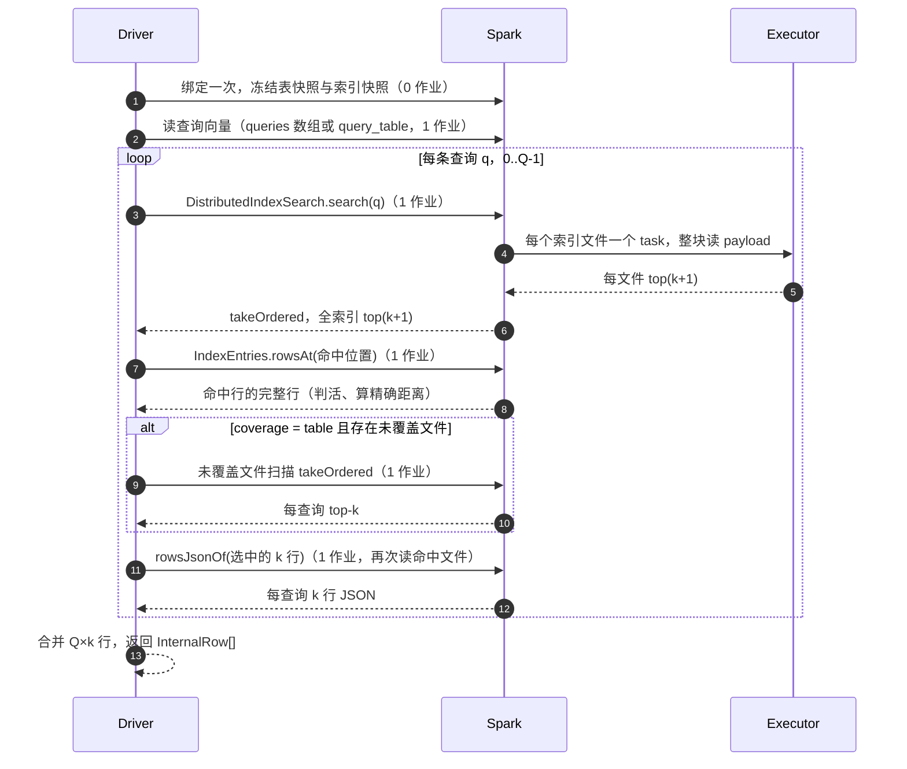
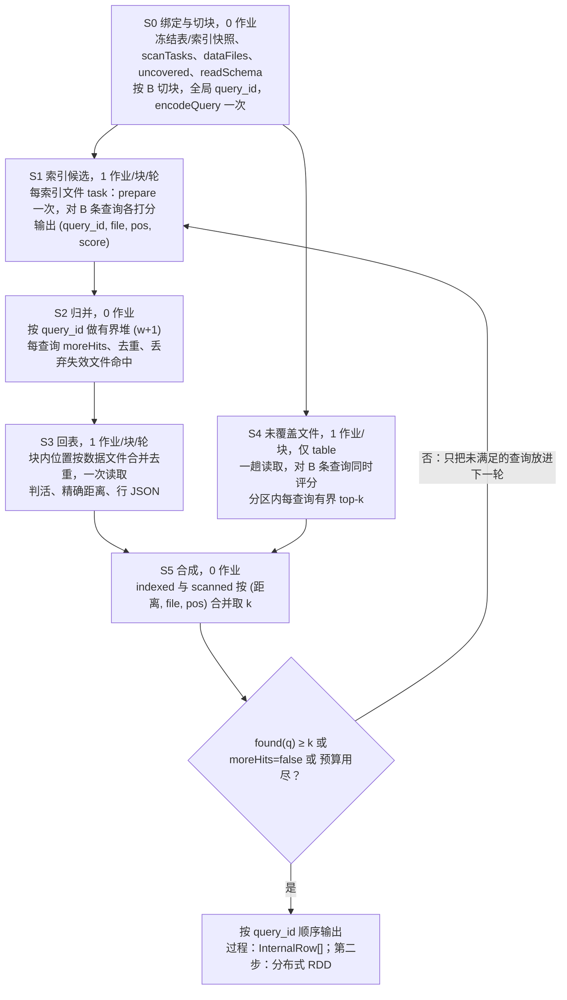
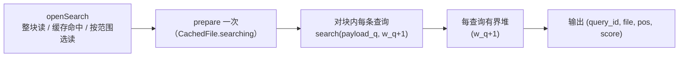

<!--
  Licensed to the Apache Software Foundation (ASF) under one
  or more contributor license agreements.  See the NOTICE file
  distributed with this work for additional information
  regarding copyright ownership.  The ASF licenses this file
  to you under the Apache License, Version 2.0 (the
  "License"); you may not use this file except in compliance
  with the License.  You may obtain a copy of the License at

    http://www.apache.org/licenses/LICENSE-2.0

  Unless required by applicable law or agreed to in writing,
  software distributed under the License is distributed on an
  "AS IS" BASIS, WITHOUT WARRANTIES OR CONDITIONS OF ANY
  KIND, either express or implied.  See the License for the
  specific language governing permissions and limitations
  under the License.
-->

# 向量批量查询共享一次分布式执行（原型设计）

状态：**第一步与 `index_hits` 批量化已实现（`0c339652f`、`37ceaba4f`）；
跨块等价与作业数已有测试覆盖，10,000 条查询的吞吐、shuffle 与峰值堆测量待目标环境。**
本文展开[向量查询性能优化路线图](../../2026-11-17-vector-query-performance-roadmap.md)
§1「批量查询共享一次分布式执行」，性能背景与「实测/推算」口径见[向量查询性能诊断](../../2026-11-17-vector-query-performance-analysis.md)。
逐条执行的基线为 `index` 分支 `b4852d6e0`，相关旧行号以其为准。本文不含工期承诺，也不提出新的用户可设参数。

## 1. 要改什么，不改什么

现状一句话：**一条查询一条 Spark DAG**。`CALL system.vector_search_batch` 在一次调用里带进来 Q 条查询，
绑定只做一次，但执行阶段仍然逐条循环（`VectorSearchBridge.scala:248` 的 `zipWithIndex.foreach`，
`index_hits` 走 `:181-223` 的同形态循环）。底层 `DistributedIndexSearch.searchBatch`（`:991`）已经做到
「每个索引文件只 prepare 一次、对多条查询各打分一次、一次作业归并」，但向量 SQL 入口没有接这条路径。

目标一句话：**一个有界查询块（query block）跑一条 DAG**。块内所有查询共享一次索引扫描、一次回表、
一趟未覆盖文件扫描；答案与逐条执行逐行一致，作业数与索引读取次数从 `O(Q)` 降到 `O(Q/B)`。

三种覆盖模式的契约必须各自保持，不能因为批量化而串味：

| `coverage` | 结果形状 | `score` | 删除/失效命中 | 未覆盖文件 |
|---|---|---|---|---|
| `table`（默认） | 命中行 + 行 JSON | 精确距离（升序） | 丢弃，并用更深的候选补齐 | 扫描，与索引候选合并取 k |
| `indexed` | 命中行 + 行 JSON | 精确距离（升序） | 丢弃，用更深候选补齐，可少于 k | 不扫描 |
| `index_hits` | 索引原始命中 + 行 JSON | 索引估计值（方向随距离函数） | 保留，`row` 为 NULL，仍占 k 名额 | 不扫描 |

不在范围内：索引格式、分组、`nlist`/`nprobe`、全局质心（路线图 §2–§4 的其余三项）；
SQL 重写路径（`VectorSearchSource`/`VectorSearchExec` 已把索引搜索与回表融合进一次作业）；
文本索引的批量入口（已走 `searchBatch`）；带过滤的检索（过程入口没有过滤参数，见 §8.6）。

## 2. 现状：Q 条查询，O(Q) 个作业

调用链：`VectorSearchBatchProcedure.call`（`VectorSearchBatchProcedure.java:120`）→
`VectorSearchCalls.plan` → `VectorSearchBridge.plan` → `BindVectorSearch.bind`（冻结快照，`BindVectorSearch.scala:43`）
→ `VectorSearchCalls.search` → `VectorSearchBridge.execute`。

绑定本身**不启动作业**：manifest、scan task、覆盖集合、`readSchema`、`entryUpperBound` 都在 driver 上算完
（`BindVectorSearch.scala:104-143`）。逐条执行的部分在 `execute` 之后：



图 1：现状的逐条执行。作业数乘 `Q`，命中文件每查询读两遍，未覆盖文件每查询扫一遍。

每查询的作业数（R = 扩探轮数，通常 1、上限 10；U = 是否存在未覆盖文件；H = 该查询是否有命中输出）：

| 模式 | 每查询作业 | Q 条查询合计 | 说明 |
|---|---|---|---|
| `table` | 2R + U + H | 典型 4Q，最坏 22Q | 每轮一次搜索 + 一次回表，再各自扫描与输出 |
| `indexed` | 2R + H | 典型 3Q，最坏 21Q | 同上，少一趟未覆盖扫描 |
| `index_hits` | R + 每批 1 次回表 | 典型 Q + 1 | 回表已整批共享，搜索仍逐条 |

具体成本（代码位置）：

- 每次搜索 = 一个作业：`DistributedIndexSearch.search`（`:800`）以 `takeOrdered`（`:947`）收口。
  每个索引文件一个 task（`IndexFileRDD.scala:51-52`），缓存关闭时每条查询把每个 payload 整块重读一遍
  （`ExecutorIndexCache` 默认关闭）。
- 每轮回表 = 一个作业：`IndexEntries.rowsAt`（`IndexEntries.java:258`）内部 `collect`（`:278`），
  每个命中文件读一次。
- 输出 JSON 又读一次：`rowsJsonOf`（`VectorSearchBridge.scala:468`）→ `rowsAtJson`（`IndexEntries.java:296`）。
  所以一个命中文件在一条查询里被读两遍（扩探轮次更多时更多次）。
- 未覆盖文件每条查询扫一遍：`uncoveredCandidates`（`VectorSearchBridge.scala:384`）→ `takeOrdered`（`:426`）。
- 驱动内存是整批尺度：`answered`（`:247`）与 `json`（`:500-523`，`index_hits` 对整批构造）同时持有
  Q×k 行及其 JSON，过程最后还要 Q×k 个 `InternalRow`（`VectorSearchBatchProcedure.java:146-157`）。
- 每次搜索重新广播 adapter、payload、`FileIO`、缓存配置（约 5 个广播/查询/轮）。

`DistributedIndexSearch.searchBatch` 正是为目标形态准备的：每文件 prepare 一次、按查询各打分一次、
`aggregateHits`（`:1411`）以 `query_id` 做 map 侧有界归并、一个作业收口（`TestDistributedIndexSearch.java:149-154`
用 job group 断言恰好一个作业）。它今天只被文本批量入口和 `IndexSearch.search`（`IndexSearch.java:149-150`）使用。
它缺两样东西，见 §4.2。

## 3. 目标形态：块内五个阶段



图 2：块内执行。每块每轮两个作业（S1、S3），`table` 模式每块多一个作业（S4）；扩探只跑未满足的查询。

各阶段的职责与不可省的细节：

- **S0 绑定与切块（0 作业）**：沿用 `BindVectorSearch.bind` 的冻结结果，块内所有查询共用同一份
  `scanTasks`、`dataFiles`、`uncoveredDataFiles`、`readSchema`、`entryUpperBound` 与索引快照。
  `query_id` 用全局序号（`start..start+B-1`），不是块内序号，避免归并后再映射出错。
  每条查询只 `encodeQuery` 一次（`VectorIndexSearch.encodeQuery`，同时完成维度校验）。
  `query_table` 输入按块流式读取（`toLocalIterator`），不把 Q×dim×4 字节整表 collect 到 driver。
- **S1 索引候选（1 作业/块/轮）**：分区仍是「一个索引文件一个 task」
  （`IndexFileRDD.scala:51-52`），task 内 `openSearch` → `prepare` 一次（缓存、选读、locality 语义全部不变），
  然后对块内每条查询各 `search(payload_q, w_q + 1)`。每条查询在每个文件最多留 `w_q + 1` 个命中，
  输出 `(query_id, file, pos, score)`。归并用 `aggregateByKey`，map 侧合并后 shuffle 记录数从
  `文件数×B×(w+1)` 个元组降到 `文件数×B` 条（每条携带 ≤w+1 个元组），驱动只收 `B×(w+1)` 个候选。
- **S2 归并（0 作业）**：每查询按 `(file, pos)` 去重（保留首个，与 `VectorSearchBridge.scala:202-207` 同规则），
  丢弃文件已不在冻结快照里的命中（与 `:324-328` 同规则），按 `w_q` 截断；`moreHits_q` 取「归并后数量 > w_q」，
  与逐条路径的 `takeOrdered(topK+1)` 判定等价。
- **S3 回表（1 作业/块/轮）**：把块内所有查询、本轮所有命中位置按数据文件合并成
  `Map<file, Set<pos>>`，调用一次 `IndexEntries.rowsAt`（`IndexEntries.java:258`）。
  同一个位置只读一次，一次读取同时供三个用途：判活、算精确距离（需要的向量列本来就在读取列里）、
  输出 `row` 的 JSON。去重后位置数上界是 `B×w`（通常 `B×k`），不是 `B×文件数`。
- **S4 未覆盖文件（仅 `table`，1 作业/块）**：`IndexEntries.liveRowsWithPositions`（`:420`）读未覆盖文件一次，
  块内 B 条查询共用这一趟读取。每行对 B 条查询各算一次精确距离，分区内每查询保留有界 top-k，
  再按 `query_id` 归并。null 向量、维度不符的行按查询各自过滤（与 `VectorSearchBridge.scala:411-416` 同规则）。
  这是穷尽扫描，给出的是未覆盖文件上的精确 top-k，不参与扩探。
- **S5 合成与扩探（0 作业判定）**：每查询把索引候选（判活后带精确距离）与扫描候选合并，
  用 `NearestFirst`（`:69-71`，距离、数据文件、行位置）排序取 k。若 `found(q) < k`、`moreHits_q`
  且预算还能增长，则只把该查询放进下一轮，`w_q` 按 `w_q + max(1, k - found(q))` 增长，总轮数上限 10
  （`:310`）。`index_hits` 的停止条件不同：它按「命中数（含 null 行）≥ k」判定（`:208`），不扩探补齐。

图 3 是 S1 中一个 task 的内部结构；它是「共享一次执行」的基本单位：



图 3：一个索引文件 task。payload 与 prepared 结构每块只准备一次，查询数只乘搜索次数，不乘读取次数。

## 4. 关键决策

### 4.1 为什么按块，B 取多少

整批（B = Q）不可行：查询 payload 要广播（Q×dim×4 字节）、每 task 要为每条查询保留堆、
驱动要同时持有 Q×k 个候选，且块越大单作业失败重试的粒度越粗。块太小则作业数与索引读取次数回升。
B 按三个预算估算，最多 128 条、至少 1 条。最后一块可以少于 B 条：

```
w = max(1, min(k × max(1, over), entryUpperBound))   （每查询初始候选宽度）
u = uncoveredFiles，仅 table 模式计入，否则为 0
s = k（u > 0），否则为 0                            （扫描侧最终回表行数上界）

B = clamp(1, 128, min(floor(payloadBudget / (dim × 4)),
                      floor(driverBudget / ((w + s) × (dim × 8 + rowOverhead)
                                            + k × (dim × 20 + jsonOverhead))),
                      floor(shuffleBudget / max(indexFiles × min(w + 1, INT_MAX) × candidateBytes,
                                                u × k × candidateBytes))))
```

Driver 项估算块内同时持有的索引回表行、扫描胜出行，以及这些行答案的 JSON。行按每维 8 字节、其余列和
包装按每行 256 字节；JSON 按每维 20 字节（一个 double 约 18 个字符加分隔符）、每行 32 字节。
索引 Shuffle 计入每文件用于判断 `moreHits` 的额外一条命中，扫描 Shuffle 只在 `table` 模式有未覆盖文件时计入。
此估算用于选块大小。实际行宽、扩探、单条查询和整批输出仍可能超出预算。

按 Q=10,000、k=10、over=0（w=10）、维度 2,560、586 个索引文件、一个未覆盖文件、广播 8 MiB、
Driver 8 MiB、Shuffle 128 MiB 估算，三个上界约为 819、9、162，推导块大小为 9。

| B | 块数 | 作业数（每块 5 个，table 模式含 S4/扫描回表/JSON） | 索引整块读取次数 | 广播 | 每块驱动候选 | 列表覆盖率（nlist=707, nprobe=32） |
|---:|---:|---:|---:|---:|---:|---:|
| **9**（推导值） | 1,112 | 5,560 | 651,632 | 0.09 MB | 90 | 34% |
| 32 | 313 | 1,565 | 183,418 | 0.33 MB | 320 | 77% |
| 64 | 157 | 785 | 92,002 | 0.65 MB | 640 | 95% |
| **128**（上限） | 79 | **395** | **46,294** | 1.31 MB | **1,280** | 99.7% |

表中的驱动候选数只计索引侧。列表覆盖率为 §4.7 的任务内共享读取预留的指标。

当预算把 B 压到 1（例如 `table` 模式、未覆盖文件、k 很大或维度很宽）时，块执行退化为逐条：索引文件不再
跨查询共享加载，且 `table` 模式比旧逐条路径多一次「扫描候选回表」作业。预算优先保证 Driver 不超限，
这种配置下方案不承诺作业数收益。

块大小是内部常量，按上面的预算推导；只为测量与测试保留内部 system property 覆盖，
不新增 Spark 会话参数（分析文档 §9.4 要求任何用户可设参数先经批准）。

### 4.2 复用 `searchBatch`：新增一个返回 `SearchOutcome` 的重载

`searchBatch` 返回 `List<List<IndexSearchResult>>`，缺少扩探循环需要的每查询 `moreHits`，
也不表达「本轮该查询请求多宽」。逐条路径的 `DistributedIndexSearch.search` 返回 `SearchOutcome`
（hits + moreHits），批量化后必须保留这个信息。做法：

- 新增 `searchBatchWithOutcomes(spark, metadata, table, List<IndexQuery>)`，返回 `List<SearchOutcome>`；
  `IndexQuery.topK()` 就是该查询本轮的候选宽度 `w_q`。
- 每条查询在每个文件都按自己的 `w_q + 1` 搜索，而不是按块内最宽查询的窗口：HNSW 的图遍历宽度是
  `max(topK, efSearch)`，用别人的窗口会改变遍历、让批量结果与单条不一致。归并时仍按每查询自己的
  `w_q` 截断、按自己的 `w_q` 判定 `moreHits`。
- `searchBatch` 保持原签名与行为（文本入口和既有测试依赖它），实现上委托给新方法或保持独立。
- 块内查询须共享相同的 `sourceTableSnapshotId` 和 `consistency`，这样才能用第一条查询解析出的索引文件。
  `adapter.searchesAllPayloadsTogether()` 的索引不走这条路径
  （文本 BM25 继续用现有的文本批查路径）。

### 4.3 回表：一次读取，同时服务判活、精确距离与 JSON

现状一个命中文件在一条查询里被读两遍：轮内回表（`VectorSearchBridge.scala:337`）算距离和判活，
`rowsJsonOf`（`:261`）再读一遍只为 JSON。批量化后：

- 位置集合是块内并集（`Map<file, Set<pos>>`），`IndexEntries.rowsAt` 已支持按位置读取，API 不变。
- 一次读取拿到完整行，判活、精确距离、JSON 都使用这份数据。`indexed` 和 `table` 模式按块对唯一行生成 JSON，
  `toJSON.collectAsList()` 会提交一个 Spark 作业。
- 完整行过一次 Driver 屏障。块限制的是临时回表行的数量，已完成块的输出仍会累积在 Driver。

### 4.4 未覆盖文件：一趟扫描，给块内所有查询评分

- 只在 `coverage=table` 且 `uncoveredDataFiles` 非空时执行，`indexed`/`index_hits` 完全跳过。
- 一趟读取、每行对 B 条查询各算一次距离；CPU 总量与逐条一致（`行数 × Q × 维度`），
  省掉的是 `Q` 趟重复 I/O 与作业数，不是算术量。用 `mapPartitions` 在分区内先保留每查询有界 top-k，
  再 `aggregateByKey` 归并到 `B×k`，驱动只收最终候选。
- 空向量、维度不符的行按查询各自过滤，与逐条路径的 `:411-416` 相同；批内不能假设所有查询维度相同
  （`queries` 数组形式允许不同长度，`encodeQuery` 会先拒绝与索引维度不符的查询）。

### 4.5 扩探在块内怎么协调

扩探状态（预算、已 found 数、`moreHits`）是每查询的，不能共享。块内按轮推进：

1. 第 1 轮：块内所有查询，宽度 `w_q = min(k × max(1, over), entryUpperBound)`。
2. S3 之后逐查询判断：`found(q) >= k` 或 `!moreHits_q` 或预算无法增长 → 该查询结束。
3. 其余查询进入下一轮，宽度按 `w_q + max(1, k - found(q))` 增长，累计不超过 `entryUpperBound`，总轮数 ≤ 10。
4. 每轮只包含未结束的查询；某一轮若只剩个别查询，这个作业就只有个别查询的负载（这是有意的：
   按查询块而非按阶段合并，避免为一条查询重跑整块）。

正常数据（无删除、无失效文件）R=1；删除或重写把命中打掉时才会出现第 2 轮。`table` 模式的扫描分支
不参与扩探，因为它已经穷尽未覆盖文件。

### 4.6 `index_hits` 的批量化差异

`index_hits` 已经是「每查询一次搜索 + 整批一次回表」（`VectorSearchBridge.scala:142-144`），
本设计把它并入 S1/S3，并保留三处差异：

- `score` 是索引估计值，排序方向由 adapter 决定（L2 升序，COSINE/DOT 降序），不能用 `NearestFirst`。
- 判不了的命中保留为 `row = NULL`，仍占 k 名额，不触发扩探（`:208` 只数命中数）。
- 不读未覆盖文件；不计算精确距离，所以 S3 只用于取行，不需要向量列以外的额外处理。

### 4.7 任务内按列表读取（第一步之后，先测再定）

第一步的收益是「payload 每块读一次、prepare 一次」；如果开启按范围选读，`prepared.search` 每条查询
仍各读自己的列表，同一个列表可能被块内多条查询重复读。第二步之后的候选做法：

1. 先在 task 内算出 `(query_id, list_id)` 集合（探哪些列表是查询期的决定，与列表内容无关）。
2. 以 list 为单位读取一次，对探测该 list 的所有查询评分；共享程度取决于列表覆盖率。
   假设各查询独立且均匀选择列表，期望覆盖率为 `1 - (1 - nprobe/nlist)^B`：`nlist=707`、`nprobe=32` 时
   B=32 为 77%，64 为 95%，100 为 99%，128 为 99.7%。按 §4.1 的预算，当前推导出的 B 约为 9，
   对应覆盖率只有约 34%；因此任务内 list 共享若要接近全覆盖，需要单独评估块大小（例如只按列表维度
   放宽块上限），不能把 B≈128 当成现状。
3. 真实数据可能集中在少数热点列表，先测每块被探列表的直方图、top-1% 列表的探测占比与最大单列表字节数，
   再决定按范围选读还是连续读。可参考 [Faiss 的批量 IVF 实现](https://github.com/facebookresearch/faiss/blob/main/contrib/README.md)。
4. 这需要 `IndexAdapter.PreparedSearch`（`IndexAdapter.java`）暴露「按 list 子集搜索」的能力，
   现有接口只有整 payload 的 `search(query, topK)`；在格式与适配器评审前不动。

## 5. 接口草图

索引层（`index-spark`）新增一个不破坏旧签名的重载：

```java
/** 每个索引文件只加载一次，返回每条查询的命中与「索引是否还有更多」。 */
public static List<SearchOutcome> searchBatchWithOutcomes(
    SparkSession spark, IndexMetadata metadata, Table table, List<IndexQuery> queries);
```

- `IndexQuery.topK()` = 该查询本轮宽度 `w_q`；返回的 `hits()` ≤ `w_q`，`moreHits()` 与逐条搜索同义。
- 断言：所有查询的 `sourceTableSnapshotId()` 与 `consistency()` 相同；adapter 不是
  `searchesAllPayloadsTogether()`。

回表直接复用现有 API，不新增：

```java
Map<String, Map<Long, Row>> rows =
    IndexEntries.rowsAt(spark, table, positionsByFile, columns, readSchema, scanTasks);
```

Spark 侧（`spark/v3.5/spark`）在 `VectorSearchBridge` 内替换两个逐查询循环：

```scala
private def nearestRowsInBlocks(
    spark: SparkSession,
    context: VectorSearchContext,
    queries: Seq[(Int, Array[Float])]): JList[Row]

// S1 + S2 + S3 + 扩探，按块返回每查询已判活的候选（带精确距离）
private def indexBlock(
    spark: SparkSession,
    context: VectorSearchContext,
    block: Seq[(Int, Array[Float])]): Seq[Seq[Candidate]]

// S4：一趟扫描，块内所有查询同时评分
private def scanBlock(
    spark: SparkSession,
    context: VectorSearchContext,
    block: Seq[(Int, Array[Float])]): Seq[Seq[Candidate]]
```

`scanBlock` 的核心是一个 `mapPartitions`：读到的每行对块内每条查询算距离，分区内保留每查询 top-k；
随后 `aggregateByKey` 归并，驱动侧拿到 `B×k` 个候选。排序方向固定为距离升序、
并列按 `(data file, position)`，与 `NearestScannedFirst`（`VectorSearchBridge.scala:74-76`）一致。

第二步若要分布式结果，新增一个物理算子（形如 `VectorSearchHitsExec`）把同样的分块管线跑成
`RDD[InternalRow]`，而不是在 `execute` 里 `collectAsList`。届时：

- 查询表带稳定 `query_id` 列，输出该列的值而不是行序号；这是**契约变更**，需要单独批准，
  不能静默改变现有 `query_id`（`int`，行序号）的含义。
- 每块的结果作为一个分区产出，按 `query_id` 排序由调用方 `ORDER BY` 或算子内完成；
  不再需要 driver 上的 `Q×k` 物化。

## 6. 成本对照（推算）

假设 Q=10,000、k=10、`over=0`、586 个索引文件、dim=2560、缓存关闭、无删除（R=1）、
存在一个未覆盖文件（U=1）、推导 B=9（块数 1,112）：

| 指标 | 现状（逐条） | 目标（按块） | 变化 |
|---|---:|---:|---|
| Spark 作业数 | ≈ 4Q = 40,000 | 块数×(2R+U+扫描回表+JSON)=1,112×5=5,560 | 约 7.2 倍减少 |
| 索引 payload 整块读取次数 | Q × 586 = 5.86M | 1,112 × 586 = 651.6k | 约 9 倍减少 |
| 命中的数据文件读取 | ≈ 每查询每命中文件 2 次 | 每块每命中文件 1 次 | 取决于命中分布 |
| 未覆盖文件扫描趟数 | Q = 10,000 | 1,112 | 9 倍减少 |
| 跨屏障候选元组 | 每查询 586×11 ≈ 6.4k | 每块 586×9×11 ≈ 58k | 总量不变（约 64M） |
| 单个执行单元临时回表行 | 每查询至多 w+s 行 | 每块至多 B×(w+s) 行 | 同一行可供多条查询复用 |
| Driver 累计结果及 JSON | 至多 Q×k 条结果 | 至多 Q×k 条结果 | 两种执行均随结果数增长 |

两点必须说清：跨屏障候选总量不随分块下降（每条查询仍要把 `文件数×(k+1)` 个元组汇总一次），
本方案直接减少作业数、索引读取次数与未覆盖扫描趟数。候选总量可以通过全局质心减少（路线图 §4）。
`CALL` 过程仍物化各块的结果及 JSON，直到分布式输出落地。Driver 总峰值需要在目标环境实测。

## 7. 实施顺序与验收

### 第一步：SQL 批量入口复用块执行（不改格式、不加参数）

1. `DistributedIndexSearch.searchBatchWithOutcomes`：在现有 `searchBatch` 的 per-file 循环上返回
   `SearchOutcome`，保留每查询 `moreHits`；补一个单测断言「一个块一个作业」与逐条结果一致。
2. `VectorSearchBridge`：把 `nearestRows` 与 `searchHits` 的两个逐查询循环换成块循环，
   按 §3 的 S0–S5 实现；`index_hits` 复用同一套 S1/S3。
3. `IndexEntries`：不改 API；确认 `rowsAt` 的 `positionsByFile` 合并路径与 `readTaskCount`
   （`IndexEntries.java:733`）在块尺度上的任务数合理。
4. 未覆盖文件批扫描：`mapPartitions` + `aggregateByKey`，只在 `table` 模式启用。
5. 修正文档里已经过时的说法：`VectorSearchBatchProcedure` 的类注释
   （`VectorSearchBatchProcedure.java:36-45`）与 `docs/docs/spark-procedures.md` 的
   「批量只读一次命中文件」只在 `index_hits` 成立，`table`/`indexed` 现在仍是逐条并读两遍。

### 第二步：查询表 + 分布式结果

1. 新增表函数入口，接受带稳定 `query_id` 列的查询表，输出该列的值（需要批准契约变更）。
2. 新增物理算子，把分块管线跑成 `RDD[InternalRow]`；过程入口保留现有的 driver 物化形状。
3. 结果按 `query_id` 分区，块内顺序由 `(score, file, pos)` 决定；调用方需要全局有序时显式排序。
4. 大批量下驱动内存与作业数都落在「块 × 阶段」的尺度，不再随 Q 线性增长。

### 实现记录

第一步与 `index_hits` 批量化已实现（`0c339652f`、`37ceaba4f`），与设计的差异记在这里：

- 块大小按 §4.1 的预算推导并封顶 128；内部 JVM 属性 `iceberg.index.batch.queries-per-block` 只用于测试与测量；`query_table` 改为 `toLocalIterator` 逐行读取。
- 每块作业数：`table` 模式为每轮 S1 + S3，另加一次 S4、一次「扫描候选回表」（S4 只返回位置与距离，入选行的行值在这里读一次）和一次 JSON 作业；`indexed` 为每轮 2 个 + 1 个 JSON；`index_hits` 为每块 1 次搜索 + 1 次整块回表。
- **单查询也走块执行**：`CALL vector_search` 的 `table`/`indexed` 与批量共用 `nearestRows`，块大小为 1。
  相对逐条实现，未覆盖文件的候选从 `takeOrdered`（无 shuffle）改成 `aggregateByKey`（一次 shuffle，
  但每个分区只上送每查询 top-k），作业数从 4 变成 5；省下的是入选的 k 行不再被读第二遍
  （旧 `rowsAtJson` 重读）。这条是按代码路径推的账，未用 event log 实测。
- 行 JSON 在 driver 上按块内唯一行序列化：`createDataFrame(本地列表)` 是 `LocalRelation`，但 `.toJSON` 之后是 `ProjectExec`，`collectAsList` 仍会启动一个作业（Spark 3.5 只有 `LocalTableScanExec` 覆写了 `executeCollect`），所以每块多 1 个作业。
- 未覆盖文件按块一趟扫描：分区内每查询一个有界堆，`aggregateByKey` 归并到每查询 top-k。
- 已验证：130 条查询跨块用例、索引建后新增文件的用例、块大小覆盖用例、作业数差分用例、HNSW 混合 topK 用例、构建后 ADD COLUMN 的 JSON 用例、不同 consistency 拒绝用例；Spark 3.5 定向测试全绿（详见看板 #26/#27/#28/#29/#31 的 note）。
- 尚未完成：10,000 条查询的吞吐、shuffle 字节与 driver/executor 峰值堆测量（需要目标集群与数据）；按 (query_id, list_id) 的任务内共享读取（§4.7）。

### 验收

- **逐行等价**：对同一快照，用逐条路径与块路径各跑 1、100、10,000 条查询，比较每条查询的
  `(query_id, data_file, pos, score, row)` 序列；并列分数按 `(file, pos)` 的顺序必须一致。
- **语义不变**：三种 `coverage` 各测一遍；覆盖删除行、构建后新增文件（未覆盖）、索引落后于表、
  `row` 为 NULL 的 `index_hits`、`k <= 0`、空查询、非法 `coverage`。
- **快照可见性**：调用中途 refresh/insert 不得改变本块读到的表/索引快照（`TestVectorSearchSharedRules`
  已有的 `aCallReadsTheSnapshotsItPlanned` 一类断言）。
- **测量**：作业数（job group）、每个源数据文件的读取次数（计数 FileIO）、命中的数据文件读取次数、
  shuffle 字节、查询吞吐（QPS 与整批用时）、driver 峰值堆；冷查询（缓存关闭）与热查询（缓存开启）分开报。
- **recall 口径**：同一距离函数的暴力检索为真值；报告必须同时给出 `used_index`、每查询候选行数、
  索引读取字节、资源口径（与诊断文档 §9 一致）。

## 8. 风险与开放问题

1. **块大小是唯一的新内部旋钮。** B 太小作业数回升，太大驱动峰值上升；默认 128 是按 §4.1 的预算
   推算的起点，必须用 32/64/128/256 四点实测后再定，且只在内部 system property 暴露。
2. **跨屏障候选总量不变。** 每条查询仍要汇总 `文件数×(k+1)` 个元组；如果实测发现这是瓶颈，
   下一步是「按文件分组减少分区数」或「在 task 内先做部分归并」，不是继续加大 B。
3. **扩探的尾部效应。** 少数查询需要第 2 轮时，块作业的并行度会骤降；需要测「每块触发扩探的查询数」
   与每轮耗时。若尾部常见，可把扩探查询攒到下一个块一起跑，但会改变每查询的延迟口径。
4. **未覆盖文件的 CPU 是 `行数×Q×维度`。** 批量化只省 I/O，不省算术；索引严重落后时 `table` 模式仍然贵。
   该情形下正确做法是 refresh 索引（路线图 §2），不是把批量扫描再优化一遍。
5. **缓存开启时收益结构不同。** 缓存命中时索引 payload 本来就只读一次，块化的主要收益退化为作业数与
   未覆盖扫描趟数；报告必须冷/热分开，不能用热查询数据证明分块收益。
6. **过滤不在本设计内。** 过程入口没有过滤参数，`context.filter` 只被重写路径使用；
   若将来批量入口支持过滤，`IndexCandidates` 是按查询不同的集合，广播与 task 内存都会变重，需要单独设计。
7. **`moreHits` 的语义。** 它表示「索引还有更多」，不等于「还有下一轮」；`searchesAllPayloadsTogether()`
   的索引恒为 false。批量实现必须原样传递，不能改写成「返回条数 == 请求条数」。
8. **`query_id` 契约。** 第一步保持 `int` 行序号；第二步输出查询表的值是类型与含义的双重变更，
   必须走批准与版本化，不能静默替换。
9. **作业失败重试粒度。** 块作业失败会重跑整块；块内的输出以 `query_id` 为键、顺序由总序决定，
   重试是幂等的。但块越大重试越贵，这是 B 的另一个上限来源。
10. **任务内列表共享读取（§4.7）依赖格式与 adapter 评审。** 在覆盖率与倾斜未测之前，不应把它算进
    第一步的收益。
