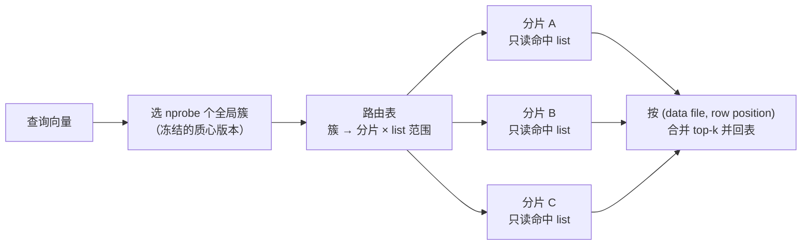
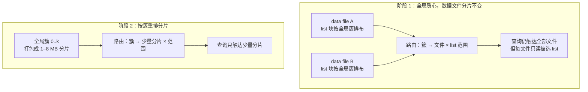

<!--
  Licensed to the Apache Software Foundation (ASF) under one
  or more contributor license agreements.  See the NOTICE file
  distributed with this work for additional information
  regarding copyright ownership.  The ASF licenses this file
  to you under the Apache License, Version 2.0 (the
  "License"); you may not use this file except in compliance
  with the License.  You may obtain a copy of the License at

    http://www.apache.org/licenses/LICENSE-2.0

  Unless required by applicable law or agreed to in writing,
  software distributed under the License is distributed on an
  "AS IS" BASIS, WITHOUT WARRANTIES OR CONDITIONS OF ANY
  KIND, either express or implied.  See the License for the
  specific language governing permissions and limitations
  under the License.
-->

# 向量全局路由降低单查询扇出（原型设计）

状态：**设计 + 单快照原型，未生产化、未验收。** 本文展开
[向量查询性能优化路线图](../../2026-11-17-vector-query-performance-roadmap.md) §4「全局路由降低单查询扇出」，
性能背景与「实测/推算」口径见[向量查询性能诊断](../../2026-11-17-vector-query-performance-analysis.md)，
现有单文件布局见[IVF 单文件分块与按范围读取](2026-11-17-ivf-list-range-read-design.md)。
基线为 `index` 分支 `888675fed`（本文所用 worktree 分支 `roadmap4-routing`），下文行号以其为准。

本文不改变公开索引格式、不新增用户可设参数、不改现有查询路径。第 7 节的原型只在
`iceberg-index-vector` 内新增类与测试；生产化所需的格式、元数据和执行计划改动在 §4、§5、§8 中列出。

## 1. 结论

现状的扇出不在算法，而在**质心空间被按文件切碎**：每个 data file（或按 `max-entries-per-index-file`
合出的组）独立训练一套 IVF，查询对**每个索引文件各探 `nprobe` 个 list**。候选数因此是
`nprobe × N / sqrt(G)`，与全局质心布局的 `nprobe × N / nlist` 相差 `nlist / sqrt(G)` 倍。

全局路由把两件事解耦：

1. **质心空间全局**：同一表快照的抽样向量训练一套（必要时两级）粗质心，所有分片共用。
2. **payload 仍是不可变分片**：分片按「全局簇 → list 块」组织，路由元数据记录每个簇覆盖的分片与
   list 位置。查询先选全局簇，再只读命中簇对应的 list 范围。

两条收益必须分开量：

| 维度 | 决定因素 | 现状 | 全局路由 |
| --- | --- | --- | --- |
| 候选行数 / 读取字节 | 探测的簇数占质心空间的比例 | `nprobe / sqrt(G)` | `nprobe / nlist` |
| 触达的索引文件数 / 任务数 | 簇是否集中在少数分片 | 全部 `F` 个 | 覆盖被选簇的分片数 |
| 回表 | 命中的 `(data file, row position)` | 不变 | 不变 |

合成数据上的单快照原型（§7）：32 个分片、每查询 8 个簇时，候选从全扫描的 32,768 降到平均 2,705
（8.3%），触达分片从 32 降到平均 6.2；如果分片按行轮转（簇散布在所有分片），候选仍降到 6.3%，
但 32 个分片全部触达。**文件扇出的下降取决于簇→分片的局部性，字节/候选的下降不依赖它。**
这一点决定了生产化的两步走（§8.1）。

## 2. 现状：公式与实测

### 2.1 写入侧

- 组 = data file 或按预算合出的组：`IndexGrouping.assign`（`IndexGrouping.java:63`）。默认
  `max-entries-per-index-file = 0`，即一个 data file 一个组（`IndexMetadata.java:53`）。
- 每组一个 task、一个 Puffin 索引文件（`SparkIndexBuilder.java:393`、`:492`）；向量索引把 payload
  写成 AUXILIARY（`VectorIndexAdapter.java:173`）。
- 每组独立训练 IVF：`IvfKernel.buildWithMemory`（`IvfKernel.java:136`）取
  `nlistFor(count)`（`IvfOptions.java:133`，缺省 `round(sqrt(entries))`），在组内采样上用固定迭代
  次数训练（`IvfKernel.java:1178`、`:1147`）。**`nlist` 与质心都是组内量。**
- 每 list 再单独训练一个 RaBitQ 量化器（`writeQuantizedList`），所以编码精度也随组走。

### 2.2 读侧

- `IndexReader.indexFiles(query)` 返回快照里所有可解码的索引文件（`IndexReader.java:250`）；
  `DistributedIndexSearch` 为每个文件建一个 task（`:354-355`），一个 task 整块读一个 payload，
  在该文件自己的质心上选 `nprobe` 个 list（`IvfKernel.java:892` 起），再合并各文件 top-k。
- `nprobe` 是**每个 payload 各自**的探测数；过滤导致结果不足时按文件翻倍（`IvfKernel.java` 过滤分支）。
- 分块格式与按范围读（`ivf-list-blocks` + `spark.iceberg.index.vector.ivf.range-read.enabled`，
  `IvfOptions.java:53`、`DistributedIndexSearch.java:1818`、`IvfListRanges.java:49`、`:102`）能把
  「读哪些 list」变成真正的 IO 旋钮，但**每个文件仍必须被打开一次**，文件数不随 `nprobe` 变化。

### 2.3 扇出公式

设表快照有 `N` 行、每组 `G` 行、组数 `F = N/G`、每文件 `nlist = sqrt(G)`、查询探测 `p = nprobe`：

```
候选行数       = p × sqrt(G) × F = p × N / sqrt(G)
扫描比例       = p / sqrt(G)
索引文件/任务数 = F                    （与 p 无关）
payload 读取字节 = 全部文件体积         （缓存关闭时整块载入，与 p 无关）
```

同一份 `N` 行上改成全局质心：`候选 = p × N / nlist`，`扫描比例 = p / nlist`。若希望 list 长度与现状
相同（`sqrt(G)` 行），全局 `nlist = N / sqrt(G) = F × sqrt(G)`，候选是现状的 `1/F`。若 `nlist = sqrt(N)`，
候选是现状的 `sqrt(G) / sqrt(N) = 1 / sqrt(F)`。两种口径对应下表两行，不能混报。

### 2.4 实测

测量口径取自性能诊断：`qwen_3_4b_embedding`，2,560 维、EUCLIDEAN，10,784,907 行 / 586 个 data file /
61.71 GB，10 条查询，k=10，12 executor × 4 core（12g 堆），缓存关闭，`nprobe=32`。

| 量 | 值 | 口径 |
| --- | ---: | --- |
| 每组行数 `G` | 18,404 | 推算 |
| 每文件 list 数 `sqrt(G)` | 136 | 推算 |
| 每查询触达索引文件 / task | **586** | 实测（每个文件一个 task） |
| 每查询候选行数 | **2,538,496（23.5%）** | 推算：`32 × N / sqrt(18,404)` |
| 每查询读 payload 字节 | **22 GB 级（整索引）** | 实测/推算，缓存关闭 |
| 索引体积 / 表体积 | ~24 GB / 61.7 GB（39%） | 推算 |
| 建索引 | 1,197,232 ms（约 20 分钟） | 实测 |
| p50（`index/over=1`） | **27,933 ms** | 实测 |
| recall@10 | **0.98** | 实测 |
| `over=1` 与 `over=10` | recall 都是 0.98 | 实测 |

对照同一快照的三种设计（性能诊断 §4.3）：

| 设计 | 质心数 | 每 list 行数 | `nprobe=32` 候选 | 32 个 list 的字节 |
| --- | ---: | ---: | ---: | ---: |
| 现状：586 组 × 136 list | 79,696（分散） | 135 | 2,538,496 | 5.3 GB（实际整文件读 22 GB） |
| 全局质心，list 长度保持 135 | 79,696 | 135 | 4,320 | 8.9 MB |
| 全局质心，`nlist≈sqrt(N)` | 3,283 | 3,284 | 105,381 | 217 MB |

关键推论：**「调大组」只有 `sqrt` 收益，且被构建期 `decodeAll` 的堆硬顶住**（整表一组需要 110 GB，
不可行）；全局路由的收益来自 `nlist` 可以与组解耦，是数量级而不是 `sqrt` 级。

## 3. 设计

### 3.1 范围与不变量

- 查询冻结一个表快照与一个索引快照；全局质心、分片和覆盖关系都来自**同一个索引快照**，不混合版本。
- 命中仍以 `(data file, row position)` 表达；删除、重写、快照不可见文件、未覆盖文件的语义不变。
- 每个条目恰好属于一个 `(簇, 分片, list)`；同一快照内所有分片的条目并集 = 索引覆盖的源数据行。
- 路由是可选的加速层：没有路由元数据的索引快照走现有逐文件 IVF；引用旧快照的读取方不受影响。
- 原型只做单层、单快照。两级路由、增量合并、重训只给设计，不在原型中实现。

### 3.2 训练共享粗质心

**样本**：在同一源表快照上抽样。样本要跨文件、跨行位置，不能只取某个文件或开头的行。
原型沿用确定性系统抽样：按固定步长跨全部条目取样，步长的起点由 seed 决定（`IvfCentroids.java`）。
样本量沿用 `IvfOptions.samplesFor`（`IvfOptions.java:143`）的「每质心 39 个样本」。
生产上样本量受两件事约束：k-means 每轮 `样本 × nlist × dim` 的 CPU，以及 driver 可容纳的样本字节。
10.78M 行、`nlist=3,283` 时样本约 128k 条，仍是千万级点积的 25 倍小。

**k-means**：固定最大迭代数（原型 25，与 `IvfKernel` 一致），起点从样本中按 seed 部分洗牌选取，
空簇保留原位；质心是簇内样本的算术平均。L2 下标量距离下这是标准 k-means；COSINE 生产化时应对
样本先归一化后求球面质心，DOT 需要单独定义「中心」的意义——原型只报告 L2。

**`nlist`**：由目标 list 长度反推，而不是由组大小派生。两个可选的起点：

- 目标候选比例 `p / nlist`（例如 1%）；
- 目标 list 字节（1–8 MB），与现有分块目标一致。

同时受质心字节约束：`nlist × dim × 4`。2,560 维时 `nlist=3,283` 的质心是 33.6 MB；`nlist=79,696`
是 816 MB，后者不适合每次查询广播。质心预算（例如 8–32 MB）是单层与两级的分界之一。

**两级路由**：当 `nlist` 大到质心字节/每查询质心打分成本不可接受，或顶层簇热点明显时，分成
`L1`（如 1,024 个粗簇）与每个 L1 下的 `L2`。查询先选 `p1` 个 L1 簇，再只在其中选 `p2` 个 L2 簇。
两级不改变覆盖模型，只是把「一个 list 的质心」从一层键换成两层键；原型不做。触发阈值：
`nlist × dim × 4 > 质心预算`，或单查询 `nlist × dim` 打分开销超过搜索预算。

### 3.3 查询选簇与覆盖关系

**选簇**：对查询向量算到所有质心的距离，取最近的 `nprobe` 个（并列按簇 id 固定顺序），
返回冻结的有序簇 id 列表。`nprobe=0` 或没有质心时返回空路由，触碰 0 个分片、0 个候选。

**覆盖关系**：路由元数据为每个簇记录它出现在哪些分片、哪些 list 范围：

```text
cluster c → [
  (shard location, list id / byte range, entry count),
  ...
]
```

一个簇可以跨多个分片（簇大于目标分片，或写入时按大小切分），一个分片也可以持有多个簇的 list。
于是路由结果就是「簇集合 → 分片×范围集合」：



覆盖表是路由元数据的主体，大小与服务方式很关键：

- 每簇平均落在 1 个分片时，3,283 簇 ×（分片 id + list id + 条目数）约几十 KB，随质心 blob 一起发布，
  driver 一次读入即可。
- 若行在分片间随机分布，一个簇会落在几乎每个分片，覆盖表退化为 `nlist × shards` 条 posting
  （586 分片时约 190 万条、20 MB 级）。这仍然可发布，但每查询的 driver 侧规划成本和广播体积要实测。
- 解决「分片太多」的手段不是压缩覆盖表，而是 §4.4 的分片布局与 §5 的合并：把簇集中到少量分片，
  覆盖表自然变小，文件扇出也才下降。

**路由查询的候选集**是命中的 `(分片, 簇)` list 范围内条目的并集。每个条目只有一个簇，所以并集
没有重复命中；`nprobe` 个簇的候选数就是这些簇的尺寸之和。过滤查询仍沿用现有 `IndexCandidates`
join：过滤把命中摊薄时，路由需要沿「次近簇」继续扩探，扩探顺序复用 `nearestCentroids` 的有序结果。

### 3.4 与「按文件合组」「列表分块」的独立对照

三条改造可以独立开关，收益来源不同，必须分开测：

| 轴 | 做什么 | 降低文件数 | 降低候选/字节 | 改变 recall 的口径 |
| --- | --- | --- | --- | --- |
| A 按文件合组 | `max-entries-per-index-file` 调大 | 是 | 候选 `nprobe×N/sqrt(G)`，仅 `sqrt` 级 | 是（每组质心变） |
| B 列表分块 | `ivf-list-blocks` + range read | 否（仍需打开每个文件） | 只降低**读取字节**，不降候选 | 否（同一 payload） |
| C 全局路由 | 全局质心 + 簇→分片/范围 | 取决于簇局部性 | 候选 `nprobe×N/nlist`，数量级 | 是（可能漏簇） |

组合关系：

- **B + C 才是完整形态**：C 决定「读哪些簇」，B 决定「怎么只读这些簇的字节」。没有 B，C 只能把
  命中分片整块载入，字节收益仍会被整文件读取吃掉；没有 C，B 只能把「每文件 nprobe 个 list」读得更省。
- **A + C 不冲突**：合组降低文件/task 数，C 降低候选；但 A 的组内 `nlist` 与 C 的全局 `nlist` 不应
  互相隐式决定，否则两者的对照会串味。
- **不改变 `over` 与现有 `nprobe` 的语义**是硬约束（性能诊断 §9.5）。C 的探测数若复用现有查询参数，
  必须由索引快照的「布局版本」显式声明，否则同一参数在新旧快照上含义不同；见 §8.6。

## 4. 元数据与发布

### 4.1 路由 blob

新增一种 AUXILIARY 索引文件（blob type 例如 `ivf-routing`），与分片文件一起列在同一个
`IndexManifest`（`IndexManifest.java`，写入见 `:78`）里，由同一个索引快照引用：

| 字段 | 内容 | 用途 |
| --- | --- | --- |
| `format-version` | 路由格式版本 | 演进与兼容 |
| `index-uuid` / `source-table-snapshot-id` | 绑定的索引与源表快照 | 校验快照绑定 |
| `metric` / `dimension` | 距离函数与维度 | 选簇打分 |
| `training` | 样本策略、样本数、seed、迭代数、训练时间、训练数据的指纹（源快照 + 文件数 + 行数） | 可重建、可审计、漂移判断 |
| `centroids` | `nlist × dimension` 的 float32（或后续量化版本） | 查询选簇 |
| `shard-refs` | 分片 id → location、entry count、质心版本、覆盖的源数据文件 | 任务规划与回表 |
| `cluster-postings` | 簇 id → `(shard id, list id / byte range, entry count)` | 选簇后定位读取范围 |
| `checksum` | 上述内容的校验 | 损坏检测 |

**兼容性**：现有 `IndexReader.readable` 只读取 adapter 声明的 blob type（`IndexReader.java:140-158`、
`IndexAdapter.java:313-329`），未知类型被记录为 skipped 而不是错误。因此新 blob 对旧 reader 是
可跳过的；旧 reader 继续按每分片自己的 IVF 搜索（每个分片 payload 必须仍是自洽的 IVF：本分片持有的
list 质心与量化器都在 payload 内），只是没有路由收益。这一点决定了分片 payload 的写法：**全局质心的
分配只改变「哪些行进哪个 list」，不改变单个 list 的编码自描述性。**

**为什么不用 snapshot property**：`IndexSnapshot` 已有 `snapshot-statistics-location` 这类属性
（`IndexSnapshot.java:60`），把路由 blob 放属性里也能工作，但会绕过 manifest 的文件清单、清理账本
（`IndexSnapshotWriter` 的 staging ledger）和 `IndexManifest` 的覆盖校验。作为 AUXILIARY 文件发布，
这三点直接复用现有机制。

### 4.2 发布与冻结

1. 构建/合并/重训在一次 attempt 内写出新分片与路由 blob，路径带快照 id 与 attempt id，先记账后写文件
   （`IndexSnapshotWriter` 的设计，`IndexSnapshotWriter.java:40` 起）。
2. 写 manifest 与 manifest list，构造新的 `IndexSnapshot`（`IndexSnapshot.builder()`），用
   `IndexMetadata.withSnapshot`（`IndexMetadata.java:255`）追加。
3. 通过 `IndexCatalog.apply`（`IndexCatalog.java:96`）发布；sidecar 实现用指针替换使新快照可见
   （`SidecarIndexCatalog.publishDocument`）。索引快照不可变，失败 attempt 按 ledger 清理。
4. 查询绑定一个表快照（`IndexQuery`）后，`IndexReader.snapshotForQuery`（`IndexReader.java:365`）
   只解析到**一个** `IndexSnapshot`；路由 blob、分片、覆盖关系都从该快照读取，因此不存在「新质心
   配旧分片」的混合读取。
5. 查询 driver 读一次路由 blob，选簇并规划任务；任务只携带 `(分片 location, list 范围)` 与查询，
   不再携带该分片覆盖的所有 scan task（见 §4.4 的回表变化）。

**发布期校验**（建议在构建端断言，失败则不发布）：

- 所有分片的 `entryCount` 之和等于路由覆盖的条目数；每个簇的 postings 条目数之和等于该簇的尺寸。
- 每个簇的 postings 中的 `(shard, list)` 在该分片 payload 的目录内；byte range 在 blob 内。
- 分片 `coveredDataFiles` 的并集等于本次快照声明的已索引数据文件集合；每个已索引文件至少被一个分片覆盖。
- 路由 blob 的 `source-table-snapshot-id` 等于快照绑定的源表快照；`index-uuid` 匹配。

### 4.3 覆盖、回表与一致性

- **未覆盖文件**：现有 `IndexReader.uncoveredDataFiles` 取所有可读索引文件
  `coveredDataFiles` 的并集（`IndexFile.java:102`、`IndexReader.java`）。分片布局变化后仍需保证
  这个并集正确；但**簇分片会让一个数据文件出现在多个分片的覆盖列表里**，最坏是每个分片都列它。
  这是 §4.4 与 §8.1 建议先做「全局质心、分片仍按数据文件」的原因之一。
- **回表**：命中携带 `(data file, row position)`。若分片不再与数据文件对齐，`DistributedIndexSearch`
  现在「每个索引任务携带其覆盖文件的 scan task」的方式会让每个任务的规划体积按覆盖数膨胀
  （`DistributedIndexSearch.java:289-302`）。生产化应把回表改成独立阶段：先合并各任务的命中，
  再按数据文件聚合并读取行；`DistributedIndexSearch.searchBatch` 的批量路径已有按数据文件合并的
  雏形。删除、失效文件命中的处理逻辑不变：冻结快照里已不存在的数据文件的命中直接丢弃。
- **重写**：旧分片里指向被重写文件的条目会变成死命中，按快照可见性过滤；被重写文件的新行进入新的
  不可变小分片。旧条目在后台合并时随旧分片一起退休，不需要单条删除。
- **删除文件**：position/equality delete 按现有回表阶段应用，与索引布局无关。

### 4.4 分片布局的两种生产形态



- **阶段 1**（推荐先做）：分片仍按 data file/现有组切分，payload 的 list 改为全局簇的桶。
  候选/字节按 `nprobe/nlist` 下降，**文件数和任务数不变**；覆盖语义、回表、增量刷新、清理全部沿用现状。
  这一步就解决了实测中 22 GB/查询的主要矛盾，代价只是重写 payload 的 list 划分（仍需重建旧索引一次）。
- **阶段 2**：按全局簇把 payload 重排成目标大小的分片，文件扇出才开始下降；代价是构建期 shuffle、
  覆盖列表膨胀、回表阶段改造、以及 §5 的合并/重训维护。

## 5. 追加、合并与重训

### 5.1 不可变小分片

- 追加/重写产生的行用**冻结的质心版本**分配簇，写出不可变小分片；不因为新写入而重训质心。
- 分片目标大小按字节（例如 1–8 MB）而不是固定行数，因为量化后每行字节数随维度和 bits 变化。
- 同一簇的多个小分片在路由表里是同一簇的多条 posting，查询会把它们一起读；分片数增长由一个上限
  或后台合并控制，否则查询的任务数/规划成本会随追加次数线性增长。
- 每个分片记录自己的质心版本；一个索引快照只允许一个质心版本（或路由 blob 显式按版本分桶），
  不做隐式混合。

### 5.2 后台合并

- 合并单位：同一簇（或相邻簇集合）的小分片 → 目标大小的分片。合并重写 list 块，旧分片在新快照里
  退休；旧快照的读者继续读旧文件。
- 写放大：每次合并重写目标字节量；以目标 4 MB、每簇 3,284 行 × 2,072 B ≈ 6.8 MB 为例，每簇一个
  目标分片，追加 1 行也要在合并时重写整个分片。控制手段是「分片内留 slack + 批量合并」：新写入先落到
  小分片，合并只在分片数或碎片字节超过阈值时触发。
- 合并的输入/输出都走 `IndexSnapshotWriter` 的 attempt 账本，失败可精确清理；发布新快照后旧分片
  进入清理窗口。
- 若 list 布局支持「同一簇的 list 块字节直接拼接」，合并可以退化为字节拼接而不重新编码；否则按
  编码器重写。当前分块格式的列表块是独立可读的，字节拼接是否成立取决于 list 目录与量化器是否
  list-local（现状是 list-local，见 `writeQuantizedList`）。

### 5.3 重训与漂移

- **触发信号**（在同一源表快照的样本上计算，发布前评估）：
  - 新样本到其最近质心的距离分布相对训练时的漂移（均值/p95 超过阈值）；
  - 空簇或超载簇比例（簇尺寸相对中位数的偏斜）；
  - 查询侧 recall@K 抽样下降，或候选数/回表量异常；
  - 表行数增长到使 `nlist` 与目标 list 长度明显失配。
- **重训 = 全量重排 + 新质心版本**：在后台对目标表快照构建新分片，完成后一次性发布新索引快照并退休
  旧分片。重排期间的写放大 = 整个索引体积，因此必须按漂移阈值摊销；不允许在线查询期间混合版本。
- 过渡期可以用「旧快照 + 未覆盖文件残扫」兜底，但这会把回表量推回全表扫描，只适合作为重训窗口的
  安全网，不是常态。
- 若只重编码 list 内码而不改变行到簇的分配（质心漂移但分片布局可复用），可以把重训拆成「重编码」
  与「重分配」两种，但两者都以新快照发布，旧快照只读。

### 5.4 写放大与存储

- 阶段 1 的追加成本与现状同量级（新 data file → 新索引文件），只是 payload 的 list 划分用全局质心。
- 阶段 2 的追加写放大 = 新行对应的分片字节 + 合并重写字节；全量重训写放大 = 索引体积。
- 同时保留父子快照意味着重训窗口的存储约为 2 倍索引体积；清理窗口按现有 snapshot 清理机制处理。

## 6. 扇出与 recall 测量方案

### 6.1 指标

每查询记录：

| 指标 | 定义 |
| --- | --- |
| `files_touched` | 任务真正打开的索引文件数（阶段 1 等于 `F`；阶段 2 是覆盖被选簇的分片数） |
| `tasks` | Spark 任务数（缓存/本地性命中不减少任务，只减少读） |
| `candidates` | 参与打分的条目数（= 被选 list 的条目数之和） |
| `index_bytes_read` | 实际读的 Puffin 字节（含 footer/描述区；range read 只计范围） |
| `payload_bytes_loaded` | 载入执行器内存的 payload 字节（缓存关闭/开启分开） |
| `recall@K` | 与同一距离函数的精确 top-K 对照；声明 K、距离函数、查询集 |
| `fetchback_bytes` | 命中 `(data file, row)` 的读取字节 |
| p50 / p95 / 吞吐 | 固定资源口径、缓存口径、快照与查询集 |

同时报告 `nlist`、`nprobe`、质心字节、每簇 posting 数、分片大小分布，否则不同布局的候选/字节不可比。

### 6.2 对照臂

在同一源表快照、同一查询集上跑：

1. **现状**：默认分组（1 file/组）+ 每文件 `nprobe`。
2. **A 合组**：`max-entries-per-index-file = 100k / 500k`。
3. **B 分块整读**：`ivf-list-blocks=true`，range read 关闭。
4. **B 分块选读**：同 3，range read 开启。
5. **C 全局质心 + 数据文件分片（阶段 1）**：B 选读 + 全局 list。
6. **C 全局质心 + 簇分片（阶段 2）**：若实现，额外测文件扇出。
7. **消融**：只换全局质心不换 payload 分片、簇分片但分片内随机、`nlist` 取 `sqrt(N)` 与「list 长度不变」
   两种口径。

### 6.3 参数网格与验收

- `nprobe = 1, 2, 4, 8, 16, 32`；`nlist` 两三种；分片目标字节 1/4/8 MB。
- recall 必须与暴力真值同批查询对照；任何只报延迟或只报 recall 的结果无效（性能诊断 §9）。
- 通过条件（建议）：
  - `candidates` 比例接近 `nprobe / nlist` 的理论值；
  - 相同 recall 下，`index_bytes_read` 与 p50 相对现状显著下降；
  - 阶段 2 的 `files_touched` 接近覆盖被选簇的分片数，并用「随机分片」消融证明下降来自布局而非偶然；
  - recall@10 相对现状下降不超过评审设定的容差，或由精排（路线图 §3）补回；
  - 冷/热、HDFS/对象存储、过滤选择性、删除文件、未覆盖文件与部分快照覆盖都必须单独报告。
- 原型数据只用于验证公式方向和实现正确性，不作为真实收益结论。

## 7. 单快照原型

### 7.1 范围

- 单表快照、单索引快照；合成数据；内存结构；只新增类与测试，不改现有查询路径、不改公开格式、
  不加用户参数。
- 原型实现了：全局粗质心训练、每条目到簇的分配、簇→分片覆盖、查询选簇、触达集合与候选集合返回。
- 原型未实现：Puffin 路由 blob、真实 payload 写入、range read 接线、Spark 调度、增量/合并/重训、
  两级路由、过滤扩探。它们的设计在 §4–§6，接入点见 §8。

### 7.2 类

| 类 | 职责 |
| --- | --- |
| `IvfCentroids` | 确定性 k-means：系统抽样（seed 决定起点）、seed 决定的初始质心、固定迭代；`nearestCentroid` / `nearestCentroids`（并列按 id）；同一份类也用于训练每分片的本地质心，作为对照臂 |
| `IvfShard` | 内存中的一个索引分片：location + 条目向量 + 行位置（行位置在原型里是分片内下标） |
| `GlobalIvfRouter` | `train(...)` = 训练质心后 `of(...)`；`of(centroids, shards)` 从已发布质心构建覆盖（生产形态）；`route(query, nprobe)` 返回 `RoutingDecision`：有序簇 id、触达分片、候选数、候选条目 |
| `RoutingDecision` | 一次路由的结果；`candidateEntries()` 是候选数，`candidates()` 是逐条候选（原型物化，生产流式读范围） |

### 7.3 合成数据与本机实测

配置：16 维、64 个真簇 × 512 行 = 32,768 行，簇内噪声 0.25，L2，K=10，64 条查询；32 个分片；
128 个全局质心；对照臂为「每分片独立 IVF，`nlist=round(sqrt(1024))=32`，每分片 `nprobe` 个 list」。
分片按真簇打包（一个分片两个真簇），这是阶段 2 的目标布局。

| 臂 | recall@10 | 候选行/查询 | 触达分片/查询 |
| --- | ---: | ---: | ---: |
| 精确扫描（真值） | 1.000 | 32,768 | 32 |
| 现状：每分片独立 IVF，`nprobe=8` | 0.933 | 8,376 | 32 |
| 全局路由，`nprobe=8` | **1.000** | **2,705（8.3%）** | **6.23** |

`nprobe` 曲线（同一批 64 条查询）：

| `nprobe` | 全局路由 recall@10 | 全局候选 | 本地 IVF recall@10 | 本地候选 |
| ---: | ---: | ---: | ---: | ---: |
| 1 | 0.795 | 416 | 0.334 | 968 |
| 2 | 0.925 | 688 | 0.523 | 2,013 |
| 4 | 1.000 | 1,379 | 0.734 | 4,143 |
| 8 | 1.000 | 2,705 | 0.933 | 8,376 |
| 16 | 1.000 | 5,284 | 1.000 | 16,325 |

分片布局消融（同一批数据，把行轮转到 32 个分片，使每个簇散布在所有分片）：

| 布局 | 触达分片 | 候选比例 |
| --- | ---: | ---: |
| 按簇打包 | 6.23 / 32 | 8.3% |
| 行轮转 | **32 / 32** | **6.3%** |

结论与 §1 一致：候选/字节的下降与分片布局无关，文件扇出的下降依赖簇局部性。合成数据簇分离良好，
全局质心几乎还原真簇，所以 recall 达到 1.0；这不代表真实高维数据也能如此，真实数据必须按 §6 重测。
这组数字只证明路由实现、确定性、公式方向与「探测越少、候选越少」的单调性成立。

确定性：同一输入 + 同一 seed 训练出逐位相同的质心与相同的路由结果；从已训练质心 `of(...)` 重建的
覆盖与 `train(...)` 完全一致。

### 7.4 测试

`TestGlobalIvfRouting` 共 13 个用例：

- 确定性：同 seed 同输入重复训练、重复路由、从已发布质心重建；
- 结构：只触达含被探测簇的分片，触达集合等于独立重算的覆盖并集，候选数等于候选集合大小；
- 扇出：按簇分片的平均触达分片 < 32（本数据 6.23），候选比例 < 15%；
- recall：与精确扫描、每分片 IVF 对照，并在 `nprobe=1..16` 上断言不下降；
- 消融：轮转分片时 32 个分片全部触达但候选比例仍 ~6%；
- 边界：`nprobe=0`（及负数）触碰 0；单簇触碰全部分片；`nprobe` 超过簇数被截断为簇数；
  空分片列表、只含空分片、混合空分片都不报错且不误触达；
- 全探测：`nprobe=clusterCount` 时候选 = 全部条目，结果与精确扫描逐条相同。

## 8. 生产化差距与风险

### 8.1 两步走

- **阶段 1（全局质心、数据文件分片不变）**：解决 22 GB/查询的字节与候选问题，覆盖/回表/刷新语义
  几乎不动，是收益/风险比最高的一步。仍然需要：payload 按全局簇写 list 块、路由 blob、查询选簇与
  range read 接线、旧索引重建。
- **阶段 2（按簇重排分片）**：才降低文件/任务扇出。需要构建期 shuffle、覆盖列表膨胀、独立回表阶段、
  合并/重训与清理。建议在阶段 1 的实测证明候选/字节收益后单独立项。

### 8.2 构建与训练

- 当前构建逐组读行、避免把向量 shuffle 到别的 task（`SparkIndexBuilder.java:393` 起）。全局抽样需要
  跨组样本：可以在各组构建前做一次有界采样作业，或在 Spark 侧用蓄水池/系统抽样汇总 driver 训练；
  两种都要报告额外的作业与数据移动。
- 训练在 driver 还是 executor：`nlist × dim` 质心与迭代可以在 driver 做（样本 128k × 3,283 质心 × 2,560 维
  是每轮数十亿次运算，driver 单线程不可行），需要 Spark 侧并行 k-means 或采样后分块训练。原型只在
  小数据上验证算法。
- 阶段 2 的 shuffle 与现有「组内不移动向量」原则冲突，必须单独评估构建时长与失败重试成本。

### 8.3 读侧

- 缓存与驻留单位从「文件」变成「(分片, list 范围)」：`ExecutorIndexCache`、`IndexPlacementPlanner`、
  `IndexCacheLocations` 都要按新单位重算容量与本地性。
- 路由 blob 的广播体积（质心 33.6 MB 量级）在大量 executor 上的峰值内存需要实测；必要时两级/量化。
- `DistributedIndexSearch` 目前每个索引任务携带覆盖的 scan task，分片不再对齐数据文件后必须改成
  两阶段回表，否则任务规划体积与内存会随覆盖数增长。
- 过滤路径的扩探（`IvfKernel` 过滤分支、`IndexCandidates` join）要改成「沿簇继续扩」，并且不能把
  「探测不到」误判成「没有结果」。
- 查询期质心打分是每查询 `nlist × dim` 的固定成本；10,000 条查询要按批量路径共享（路线图 §1）。

### 8.4 格式与 API

- 新 blob type 与路由 blob 的字段是格式变更，需要按仓库流程评审；原型没有改任何格式。
- `IndexReader`/adapter 需要新的只读路由元数据入口；是否提升为公开 API 要单独评审（保持包内可见优先）。
- 旧 reader 跳过路由 blob 的兼容路径必须被测试覆盖；旧快照的查询路径不能回归。
- 回表、删除、未覆盖文件的语义测试要覆盖「命中的分片不再拥有覆盖的 data file」这类新组合。

### 8.5 recall 与过滤风险

- 全局粗质心可能在真实高维数据上漏簇；`nprobe` 曲线、两级路由与精排（路线图 §3）是缓解手段，
  但不能用「分数更准」掩盖「候选没被探测到」。
- 分片按簇重排后，热点簇会集中到一个分片，任务倾斜需要按簇尺寸拆分分片（§5.1）。
- 过滤把命中摊薄，路由扩探的代价与上限要单独测量；不能静默改变现有 `over`/`nprobe` 语义。

### 8.6 `nprobe` 语义

现有 `nprobe` 是每个 payload 的探测数。全局路由下它若表示「全局簇数」，同一参数在新旧索引上的含义
不同，属于不兼容的语义变化。生产化必须二选一：由索引快照显式声明布局版本并让查询按版本解释参数，
或新增一个经批准的独立参数。原型没有改动任何查询参数；路线图 §4 也明确第一轮不引入新格式与新参数。

## 9. 未完成项

- 真实表快照上的构建与查询实测（本轮只有合成数据）；HDFS/对象存储、冷/热缓存、过滤、删除、未覆盖
  文件都没有实测。
- Puffin 路由 blob 的写入、读取、校验、发布与清理；`IndexReader`/adapter 的路由读取入口。
- 生产 k-means（并行/两级）、样本策略的成本模型、质心版本与漂移检测。
- 增量小分片、后台合并、重训与写放大实测。
- 阶段 2 的构建期 shuffle、回表两阶段化、缓存/驻留单位改造。
- 与精排、批量执行、列表分块三者的组合实测。

## 10. 验收清单

- [ ] 设计评审确认「阶段 1 先做、阶段 2 单独立项」，以及 `nprobe` 语义的版本化方案。
- [ ] 路由 blob 格式评审通过（字段、校验、兼容与回退）。
- [ ] 同一快照上按 §6 跑完 1/100/10,000 条查询的对照臂，报告候选、字节、文件/task 数、recall、p50/p95。
- [ ] 阶段 2 的文件扇出下降由「按簇分片 vs 随机分片」消融证明。
- [ ] 删除、重写、未覆盖文件、部分快照覆盖的语义测试通过。
- [ ] 追加、合并、重训的写放大与漂移数据齐全，清理窗口与失败恢复流程演练过。
- [ ] 现有 `over`/`nprobe`/缓存/列表分块路径无回归。
